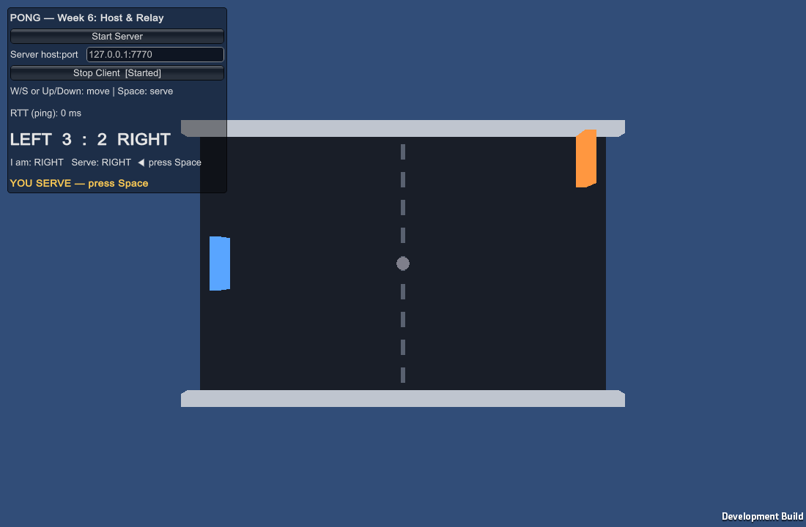
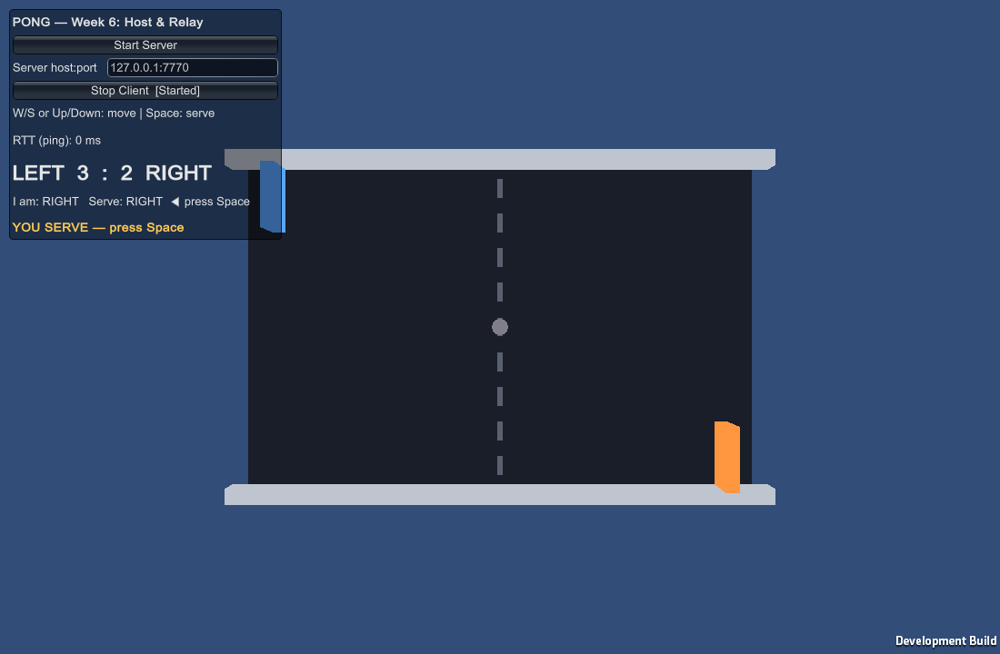

# Automated local matches

These are real local matches between two independent Windows game processes. Each bot controlled its own paddle through Unity Input System keyboard events. NetworkBall detected goals and GameState updated scores.

| Match | Host | Guest | Score | Guest RTT | Host duration |
| --- | --- | --- | --- | --- | --- |
| 1 | Bot A | Bot B | 3-2 | 0 ms | 50.90 s |
| 2 | Bot B | Bot A | 3-2 | 0 ms | 55.62 s |

## Bot behavior

Both bots initially track the ball Z position to rally. After five seconds, one bot deliberately moves away from the ball; the intended losing side alternates to keep the match finite. Goals are produced through normal game logic. No direct score, ball-position or paddle-position writes are used, and T/G cheats are not pressed. The serving bot presses Space.

These are controlled same-PC tests over **127.0.0.1 with UnityTransport**, not two humans on different networks. Relay was tested separately.

## Actual English-interface screenshots

### Match 1: guest view

### Match 2: guest view

## Repeat the match

Select **Week06 > Build and play automatically (two players)**. The Editor builds Windows, starts the host, waits for its LEFT paddle, then starts the guest. Bots play until one side reaches 3. Screenshots and JSON results are written to `Assets/Week06/AutoMatches/Run-...`.

`Week06AutoMatch.cs` compiles only in the Editor or Development builds and creates no bot unless `-auto-role` is supplied.
