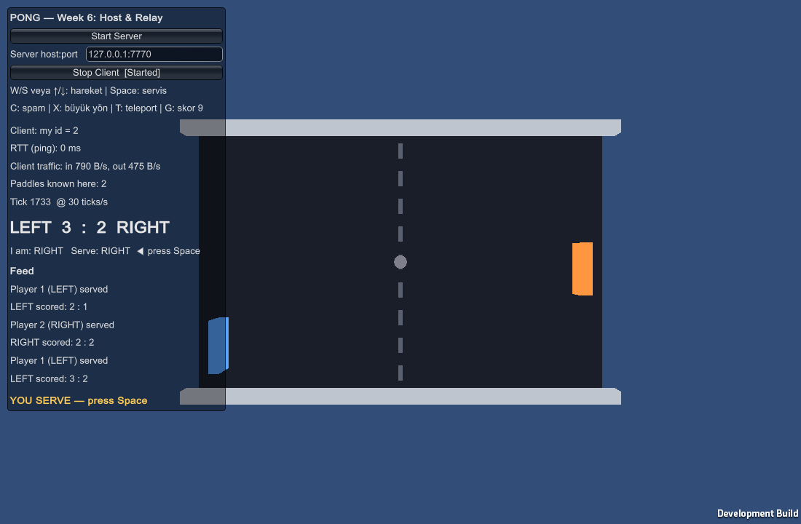
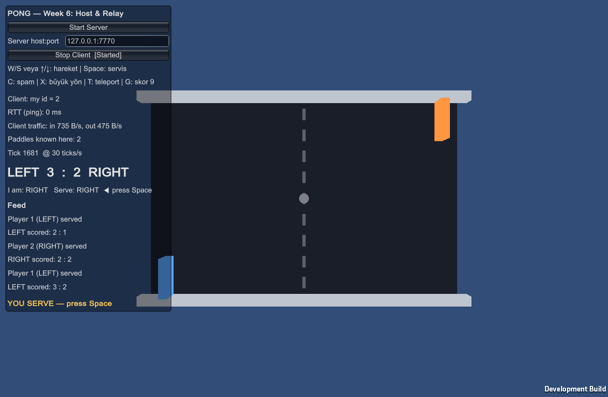

# Kendi kendine oynanan maçlar

Bu rapor gerçek iki Windows oyun sürecinin oynadığı yerel maçlara aittir. Her iki süreç de kendi raketini Unity Input System klavye olaylarıyla kontrol etti. Golü NetworkBall, skoru GameState hesapladı.

| Maç | Host | Misafir | Sonuç | Misafir RTT | Süre (host) |
| --- | --- | --- | --- | --- | --- |
| 1 | Bot A | Bot B | 3–2 | 0 ms | 58.26 s |
| 2 | Bot B | Bot A | 3–2 | 0 ms | 56.47 s |

## Oyun davranışı

Botlar önce topun Z koordinatını takip ederek ralli yapar. Ralli beş saniyeyi geçince sırayla bir bot topu kaçıracak yöne gider; böylece maç makul sürede puan üreterek biter. Puan elle yazılmaz, T/G hileleri kullanılmaz ve top/raket konumu doğrudan ayarlanmaz. Servis sırası gelen bot Space gönderir.

Bu kontrollü deneydir; iki insanın farklı ağlardan oynadığı maç olarak sunulmamalıdır. Ağ: **127.0.0.1, UnityTransport**. Relay veya ikinci ağ kullanılmadı.

## Gerçek ekran görüntüleri

### Maç 1: misafir ekranı

### Maç 2: misafir ekranı

## Yeniden oynat

Unity menüsünden **Week06 > Build and play automatically (two players)** seç. Windows build alınır, hostun LEFT raketi beklenir, misafir bağlanır ve botlar bir taraf 3 puana ulaşana kadar oynar. Ekran görüntüleri ve JSON sonuçları `Assets/Week06/AutoMatches/Run-...` içine yazılır.

`Week06AutoMatch.cs` yalnız Editor veya Development buildde derlenir ve `-auto-role` parametresi olmadan bot oluşturmaz.
