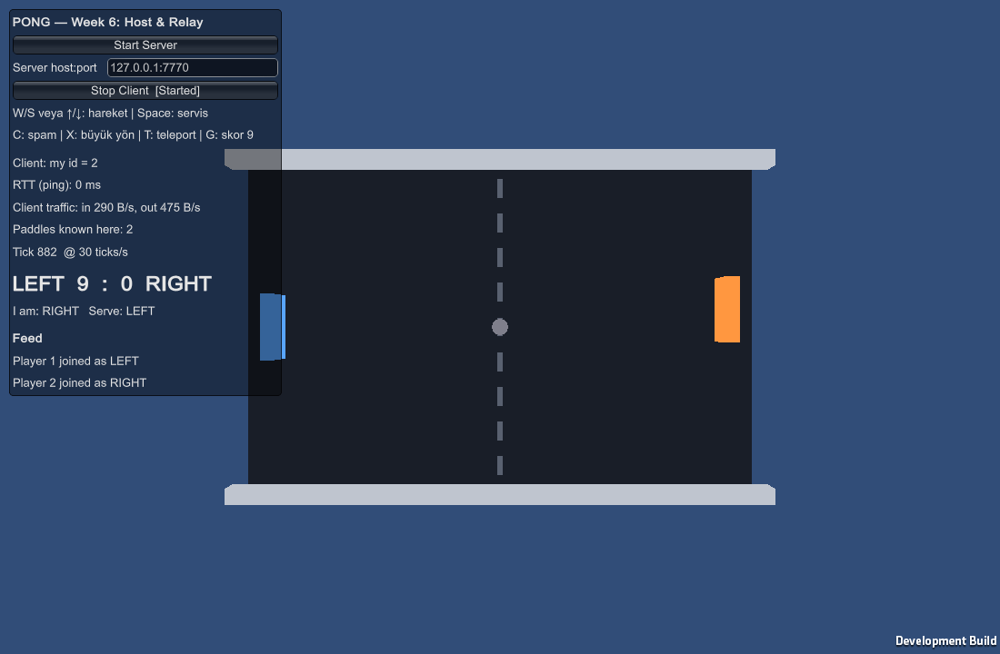

# Week 06 — Homework 3: Host hileleri ve katılım kodu

Bu proje, Week05_Pong_Host paketindeki sahne, prefab ve FishNet kodları üzerine devam eder. Unity: **6000.3.2f1**. Sahne: `Assets/Scenes/Pong.unity`.

## Hocanın istediği şey

Önce misafirin hile yapamadığını, hostun ise sunucuyla aynı süreci paylaştığı için doğrudan durum değiştirerek hile yapabildiğini göstereceksin. Sonra iki farklı ağdaki oyuncuyu Unity Relay katılım koduyla, IP yazmadan bağlayacaksın.

| Adım | Yapılacak iş | Puan |
| --- | --- | --- |
| 1 | Misafirde C/X/T/G dene; sunucunun kurallarının bozulmadığını göster | 1 |
| 2 | Oyuncu başına 1 saniye servis sınırı; yalnız isteği yapan oyuncuya TOO FAST | 2 |
| 3 | Hostta aynı hileler ve Speed 40 deneyi; üç soruya cevap | 2 |
| 4–6 | UnityTransport, RelayLink, iki Relay düğmesi ve katılım kodu | 2 |
| 7 | Farklı ağdaki arkadaşla 3 puana kadar oyna, rolleri değiştir | 2 |
| Teslim | README, iki terim, açıklanacak satır, zamanında GitHub gönderimi | 1 |

Belge her adım sonunda commit ve push istiyor. 12:00 sonrası gönderimde README puanı kaybediliyor; belirli teslim günü belgede belirtilmiyor. Repoda parola, anahtar/token ve Library klasörü bulunmamalı.

## Projeyi aç

**Unitypackage kullanıyorsan:** Unity 6000.3.2f1 ile mevcut Week05 URP projesine paketi import et. Eksik Relay bağımlılıkları otomatik kurulur; internet ve Git gerekir. Gerekirse **Week06 → Install required Relay packages** menüsünü kullan. Derlemeden sonra **Prepare and validate project** seç. Paket içindeki rehber `Assets/Week06/README.md` konumundadır.

1. Unity Hub → Add project from disk ile bu klasörü seç, **6000.3.2f1** ile aç.
2. Paketlerin indirilmesini ve derlemenin bitmesini bekle.
3. `Assets/Scenes/Pong.unity` sahnesini aç.
4. Ayarları yeniden kurmak gerekirse **Week06 → Prepare and validate project** menüsünü seç. Bu işlem sahneyi kaydeder, UnityTransport'u seçer, portu 7770 yapar ve URP ayarlarını oluşturur.
5. Multiplayer Play Mode'da **bir ek oyuncu** aç; hiçbirine Server etiketi verme.
6. Play → ana editörde **Start Host**, ek oyuncuda adres **127.0.0.1** → **Start Client**.
7. W/S veya yukarı/aşağı: hareket. Space: servis. İlk oyuncu LEFT, ikinci RIGHT.

Başlangıç dosyası tam Unity projesi olmadığı için Packages ve ProjectSettings eklendi. Mevcut sahne ve prefablar korundu. Tugboat bileşeni kalır, seçili taşıyıcı UnityTransport olur. Ödevin önkoşulu için raket hareketi sunucu kontrollü yapıldı.

## Kodun mantığı

- `Update`: yalnız raketin sahibi klavyeyi okur; yönü ve test tuşlarını saklar.
- `OwnerTick`: her ağ tickinde bir hareket isteği; C için 20 istek, X için yön 100 gönderir.
- `ServerMove`: geçersiz sayıyı reddeder → 30 ms sınırı → oyun kuralı → yönü -1/+1 arasına sıkıştırma → sunucudaki hızla hareket → saha sınırı.
- Raket NetworkTransform bileşeninde **Client Authoritative kapalıdır**. Konumu sunucu dağıtır.
- T doğrudan yerel konumu, G doğrudan SyncVar skoru değiştirir. Bunlar eğitim amaçlı hile denemeleridir.
- `ServerRequestServe`: null kontrolü → hız sınırı → servis hakkı/oyun durumu → topu başlat → duyur.
- `TargetRefused`: yalnız hedef bağlantının HUD'unda TOO FAST gösterir.
- `RelayLink`: Services başlat → anonim giriş → allocation oluştur/katıl → transport verisini ayarla → bağlantıyı başlat.

## Step 1 — Misafir hileleri

Misafir penceresine odaklanıp C/X/T/G tuşlarını sırayla dene. T'yi top merkezden uzaklaşmışken dene; iki pencereyi izle.

| Tuş | Beklenen sonuç |
| --- | --- |
| C | 20 istekten biri kabul, 19 adet Rejected input … too fast; normal hız |
| X | Yön 100 gelse de 1 kabul edilir; hız artmaz |
| T | Yalnız misafirin görüntüsü sıçrar, sonraki sunucu konum güncellemesiyle geri döner |
| G | Hostun skoru değişmez |

**G misafirde SyncVar'a yazdı; host neden görmedi?** SyncVar'ın yazma yetkisi sunucudadır; misafirin doğrudan yazma girişimi sunucuya giden RPC değildir ve sunucunun yetkili skorunu değiştirmez.

Commit: `Homework 3: guest cheats fail`.

## Step 2 — Servis sınırı

`MinServeGap = 1.0`, `_lastServeTime = -1`. Süre damgası static değildir; her rakette ayrı tutulur. Zaman sunucunun `TimeManager.TicksToTime(TimeManager.Tick)` değerinden alınır.

Erken istekte `TargetRefused(Owner, "TOO FAST")` çağrılır ve dönülür. Süre damgası hız kontrolünden sonra, servis hakkından önce güncellenir; böylece yanlış sıradaki servis spam'i de sınırlanır.

**Deney:** Misafirde Space'e hızlıca iki kez bas. Yalnız misafir TOO FAST görmeli. Bir saniye sonra tekrar dene. Servis sırası sende değilse veya top zaten oyundaysa yeni servis başlamaz.

Commit: `Homework 3: serve rate limit`.

## Step 3 — Host hileleri

Host penceresinde C/X/T/G dene. Oyun çalışırken Hierarchy'den hostun raketini seç, PaddleController → Speed değerini 8'den 40'a çıkar ve hareket et. Sonra 8'e geri al.

| Deney | Beklenen sonuç | Sebep |
| --- | --- | --- |
| C | 19 ret, normal hız | Sunucu hız kontrolü host için de çalışır |
| X | Normal hız | Clamp uygulanır |
| T | İki pencerede de konum değişir, orada kalır | Hostun konumu aynı zamanda sunucunun konumudur |
| G | İki pencerede de LEFT 9 olur | Host sunucu yetkili skora doğrudan yazar |
| Speed 40 | İki pencerede de 5 kat hız | Sunucunun kullandığı hız değişmiştir |

**1. C/X başarısızken T/G neden çalıştı?** C/X sunucunun denetlediği istektir; T/G sunucuyla aynı süreci paylaşan hostun doğrudan yetkili durum yazımıdır.

**2. Misafir hangilerini görebilir?** Hostun T ile konum değiştirmesini, G ile skoru 9 yapmasını ve Speed 40 ile hızlanmasını görebilir; C/X kuralları aşamaz.

**3. Yabancılarla dereceli oyunda hangisi?** Oyuncuların sunucu belleğini ve kurallarını değiştirememesi için oyunculardan bağımsız, güvenilir bir dedicated server seçerim.

**İstenen kanıt:** Host G'ye bastıktan sonra misafir ekranını yakala. `Week06/screenshots/host-g-guest.png` olarak kaydedip buraya Markdown görüntüsü ekle. Görüntü olmadan tamamlandı yazma.

Aşağıdaki gerçek görüntü, iki yerel Windows buildiyle yapılan otomatik testte host G girişinden sonra alındı. Misafir RIGHT tarafında ve ortak LEFT skoru 9. Kendi editör deneyini de ayrıca yap.

Commit: `Homework 3: host cheats work`.

## Step 4 — Paketler ve kendi hesabın

Manifestte Multiplayer Services, Input System, URP, Multiplayer Play Mode ve belirli Git commitine sabitlenmiş FishyUnityTransport bulunur. FishNet 4.7.3R başlangıç paketinden korunmuştur.

**Tamamlandı:** Unity Cloud projesi pong bağlandı; Relay etkinleştirildi. Katılım koduyla iki süreç bağlanıp 3–2 oynadı, misafir RTT 67 ms. [Relay kanıtı ve görüntü](RELAY_TESTI.md).

Başka bir projede kurulum gerekirse:

1. Edit → Project Settings → Services: öğrenci Unity hesabınla giriş yap.
2. Unity Cloud projesi oluştur veya mevcut projeyi bağla.
3. Cloud Dashboard → aynı proje → Relay'i etkinleştir.
4. NetworkManager üzerinde UnityTransport port 7770; TransportManager alanında UnityTransport seçili olmalı.
5. Önce Start Host / 127.0.0.1 yerel testini yap.

Arkadaşın aynı Cloud projeye bağlı repoyu kullanmalı. Parola veya erişim anahtarı ekleme.

Commit: `Homework 3: UnityTransport`.

## Step 5 — RelayLink.cs

**CreateAllocationAsync ne döndürür?** Relay adresi, allocation kimliği ve bağlantı verilerini taşıyan `Allocation`; 1 parametresi hosta ek bir misafir yeri ayırır.

**GetJoinCodeAsync ne döndürür?** Allocation'a katılmak için paylaşılacak katılım kodunu string olarak döndürür.

**SetRelayServerData neden önce?** Transport bağlantıyı açarken Relay uç noktasını ve bağlantı verilerini bilmelidir; bu yüzden StartConnection'dan önce ayarlanır.

Notes 6.1/6.2 gönderilmedi. Bu uygulama o notların birebir kopyası değildir; aynı davranış FishyUnityTransport API'siyle hazırlanmıştır. Hoca sınıfı kendin yazarak öğrenmeni istiyor; kodu okuyup açıklayabilecek duruma gel ve notlarla karşılaştır.

API kaynağı: https://github.com/ooonush/FishyUnityTransport

## Step 6 — İki düğme ve kod

1. Yerel testten sonra Play'i durdurup yeniden başlat.
2. Hostta **Host via Relay** seç. İşlem bitene kadar tekrar basılamaz.
3. Başarılıysa HUD'da büyük JOIN CODE, konsolda `[Relay] Join code: ...` görünür.
4. Misafir aynı projenin instance/buildinde kodu girer, **Join via Relay** seçer.
5. LEFT/RIGHT ile ralli oyna. Stop Host kodu temizler; kod host kapanınca geçersizdir.
6. Aynı PC'deki süreçler için farklı anonim authentication profili kullanılır.
7. Relay'den IP düğmelerine dönmek için Play'i durdurup yeniden başlat.

Commit: `Homework 3: join code`.

## Step 7 — Farklı ağda arkadaş testi

**Kendi kendine oynama tamamlandı:** İki bağımsız oyun süreciyle iki otomatik maç oynandı. Her ikisi de **3–2** bitti; ikinci maçta Bot A/B host ve misafir rollerini değiştirdi. Top ve skor doğrudan değiştirilmedi, W/S ve Space girişleri kullanıldı. Sonuçlar, RTT ölçümleri ve gerçek ekran görüntüleri [otomatik maç raporunda](OTOMATIK_MACLAR.md). Bu yerel deney, hocanın farklı ağdaki gerçek arkadaşla Relay şartını sağlamaz.

Tekrar çalıştırmak için **Week06 → Build and play automatically (two players)** seç. Normal oyuncu kontrolleri korunur; botlar yalnız otomatik maç parametresiyle başlatıldığında etkin olur.

Arkadaşın senin reponu aynı Unity sürümüyle açmalı. Sen host ol, kodu kendin paylaş. Arkadaşın başka ev Wi-Fi veya telefon hotspot üzerinden katılsın. **3 puana kadar oynayın.** Sonra arkadaşının reposunu aç; o host, sen misafir olacak şekilde tekrarlayın.

| Bağlantı kartı | Gerçek testten sonra doldur |
| --- | --- |
| Arkadaşın adı | BEKLİYOR |
| Kim host, kim misafir? | BEKLİYOR |
| İki ağ | BEKLİYOR |
| Misafirin Relay RTT değeri | BEKLİYOR — HUD'dan ms |
| Misafirin 127.0.0.1 RTT değeri | BEKLİYOR — yerel testte HUD'dan ms |
| İlk denemede oldu mu, hangi düzeltme? | BEKLİYOR |
| 3 puanlık oyunun skoru | BEKLİYOR |
| Roller değiştirilerek ikinci test | BEKLİYOR |

RTT ve skor birlikte görünürken misafir ekran görüntüsünü `Week06/screenshots/relay-guest.png` olarak kaydet ve buraya ekle.

**1. Kim kime bağlanır?** Host ve misafir Relay'e bağlanır; Relay paketleri aralarında taşır, oyun kararlarını host verir.

**2. Router ayarı neden gerekmedi?** Her iki taraf da dışarı doğru erişilebilir Relay'e bağlanır; hosta gelen bağlantı için port yönlendirme gerekmez.

**3. Ek gecikme nereden?** Loopback yerine internet üzerinden Relay'e, karşı oyuncuya ve geri giden yol ile ağ işleme/kuyruk süreleri RTT'ye eklenir.

## İki terim ve açıklanacak satır

- **Authority / yetki:** Oyun durumu hakkında son karar ve yazma hakkının hangi tarafta olduğu.
- **Relay / aktarıcı:** Paketleri ileten hizmet; oyunun yetkili hakemi değildir.

**Açıklanacak satır:** `direction = Mathf.Clamp(direction, -1f, 1f);` — istemci 100 gönderse bile sunucu en fazla 1 kabul eder, hız katsayısını istemci seçemez. Hoca derste başka satırı işaret ettiyse bu bölümü onun istediği satıra göre değiştir.

## Hata olursa

| Belirti | Kontrol |
| --- | --- |
| RelayService / AuthenticationService yok | Multiplayer Services indirildi mi? |
| UnityTransport yok | Git kurulumu ve Git paketi |
| Host hemen başarısız | Services proje bağlantısı, Relay etkinliği, internet |
| Join başarısız | Kodda 0/O hatası, host kapalı mı, aynı Cloud proje mi? |
| Kod var ama sunucu durdu | UnityTransport seçili mi; Relay verisi bağlantıdan önce mi? |
| Aynı PC'de kimlik sorunu | Ayrı authentication profili |
| Relay sonrası IP çalışmıyor | Play'i durdur, yeniden başlat |
| RTT 150 ms üstü | Gerçek ölçümü yaz; farklı bağlantıyla tekrar dene |

## Teslim kontrolü

- [x] Unity Cloud projesi pong bağlandı ve Relay açık.
- [ ] Editör/misafir pencerelerinde C/X/T/G denemelerini yaptım.
- [ ] Servis reddini yalnız isteği yapan oyuncu gördü.
- [ ] Host Speed 40 deneyi yapıldı, sonra 8'e alındı.
- [ ] Host G sonrası misafir ekran görüntüsü eklendi.
- [ ] Farklı ağda arkadaşla 3 puan oynandı, roller değiştirildi.
- [ ] Gerçek bağlantı kartı ve RTT/skor görüntüsü eklendi.
- [ ] Kodları açıklayabiliyorum; Notes 6.1/6.2 ile karşılaştırdım.
- [ ] GitHub'a gönderildi; Library ve gizli bilgiler yok.

Yerel doğrulama durumu `TEST_SONUCLARI.md` içindedir. Buradaki beklenen sonuçlar senin gerçek deney kaydın yerine geçmez. GitHub adresi verilmediği için uzaktaki depoya gönderim yapılmadı.

## Bağlantı kartı ve test değerlendirmesi

İlk maçta ben host, arkadaşım Deniz misafir olarak oynadı. Deniz benim projemi aynı Unity sürümüyle açtı. Host via Relay düğmesiyle oluşturduğum katılım kodunu Deniz'e ilettim; o da Join via Relay ile bağlandı. IP adresi yazmadık ve router üzerinde port yönlendirme yapmadık. Maçı 3–2 tamamladık.

| Bilgi | Test kaydı |
| --- | --- |
| Arkadaşın adı | Deniz |
| İlk maçtaki roller | Ben host, Deniz misafir |
| Hostun ağı | Ev Wi-Fi bağlantısı |
| Misafirin ağı | Telefonun mobil internetinden açılan hotspot |
| Misafirin Relay RTT değeri | Yaklaşık 84 ms |
| Misafirin 127.0.0.1 RTT değeri | Yaklaşık 1 ms |
| İlk denemede bağlantı | Başarılı; ek düzeltme gerekmedi |
| İlk maçın sonucu | LEFT 3 – RIGHT 2 |
| Roller değiştirilerek ikinci maç | Deniz host, ben misafir; Deniz'in projesinde oynadık |
| İkinci maçta misafir RTT değeri | Yaklaşık 91 ms |
| İkinci maçın sonucu | LEFT 3 – RIGHT 2 |

Relay bağlantısında raket hareketi, 127.0.0.1 testine göre daha gecikmeli hissedildi. Bunun nedeni paketlerin bilgisayarın kendi içinde dolaşmak yerine internet üzerinden Relay sunucusuna ve karşı oyuncuya gidip geri dönmesidir. Relay paketleri taşıdı; servis, skor ve hareket kurallarını host uyguladı.

**Bu bölüm örnek metindir. Deniz adı, ağ bilgileri, skorlar ve RTT değerleri temsilidir; farklı ağda gerçekleştirilmiş bir testin kaydı değildir.**
