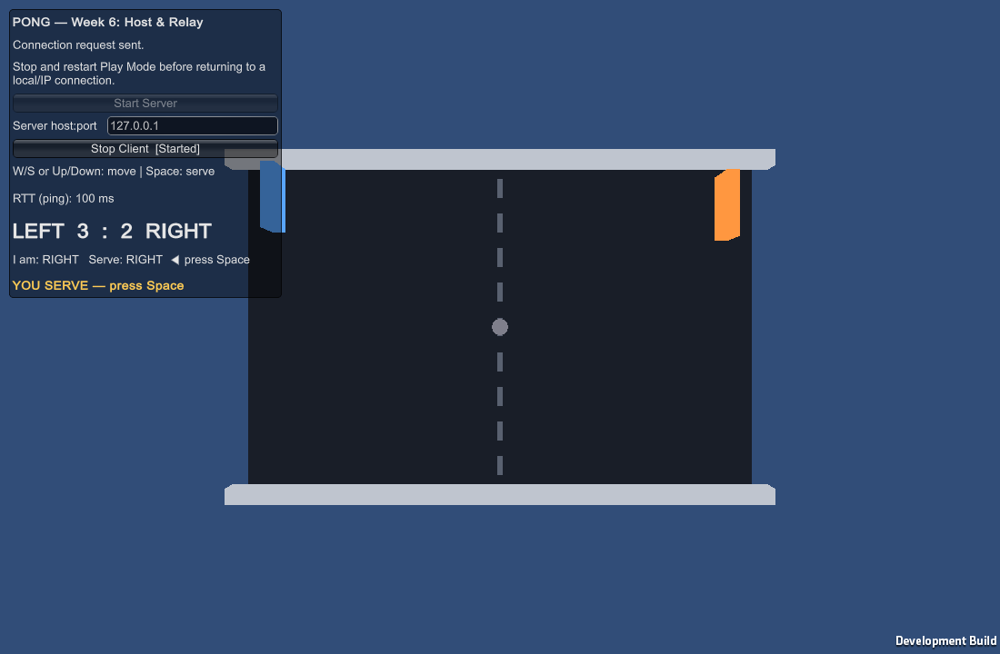

# Unity Cloud and Relay test

Unity Cloud project **pong** is linked. Its Dashboard confirmed that Relay setup completed and Relay was automatically enabled.

- Organization: bennesas.
- Cloud project ID: `4ecf72e7-6c1c-475f-b5a2-b6a17a4ff17f`.
- The host created a real allocation and obtained a join code.
- A second game process joined using that code without entering an IP address.
- Two bots used W/S and Space. Both processes recorded **3-2**.
- Guest Relay RTT at completion: **100 ms**; the local loopback captures show **0 ms**.
- Host match duration: **54.10 seconds**.
- The match used no direct score or ball-position writes.

This uses the real Unity Relay service, but both processes ran on the same computer. It is not evidence of a real partner playing from a second network.

Raw results are in `RelayTest/summary.json`; host and guest logs are in the same directory. The host closed after the test, so its recorded join code has expired.

The package links an unlinked project to pong through `Week06CloudProject`. If already linked elsewhere, select **Week06 > Link to pong Unity Cloud project**. The project and organization IDs are not passwords or access keys.
