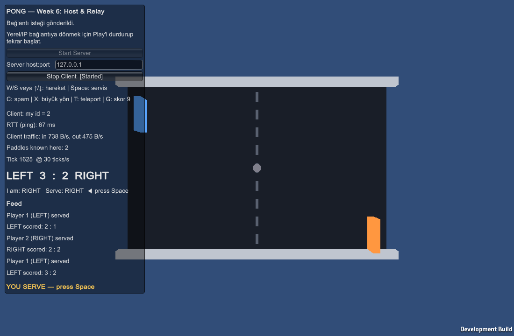

# Unity Cloud ve Relay testi

Unity Cloud projesi **pong** bağlandı ve Dashboard'da Relay kurulumu tamamlanıp etkinleştirildi.

- Organization: bennesas.
- Cloud project ID: `4ecf72e7-6c1c-475f-b5a2-b6a17a4ff17f`.
- Host gerçek Relay allocation oluşturdu ve katılım kodu aldı.
- İkinci oyun süreci katılım koduyla bağlandı; IP adresi kullanılmadı.
- İki bot W/S ve Space girişleriyle oynadı. Skor iki tarafta **3–2** oldu.
- Misafir RTT: **67 ms**. Önceki 127.0.0.1 testinde **0 ms**.
- Host tarafında geçen süre: **56.70 saniye**.
- Skor veya top konumu doğrudan yazılmadı.

Bu test gerçek Unity Relay hizmetini kullanır; iki süreç aynı bilgisayardadır. Farklı ağdaki gerçek arkadaş deneyi olarak sunulmamalıdır.

Ham sonuçlar `RelayTest/summary.json`, host ve misafir logları aynı klasördedir. Test sonunda host kapandığı için kullanılan katılım kodu artık geçerli değildir.

Unitypackage, boş Cloud bağlantısı olan projeyi `Week06CloudProject` aracılığıyla pong projesine bağlar. Başka Cloud projesine önceden bağlı bir proje için **Week06 > Link to pong Unity Cloud project** menüsünü seç. Bu kimlikler erişim anahtarı veya parola değildir.
