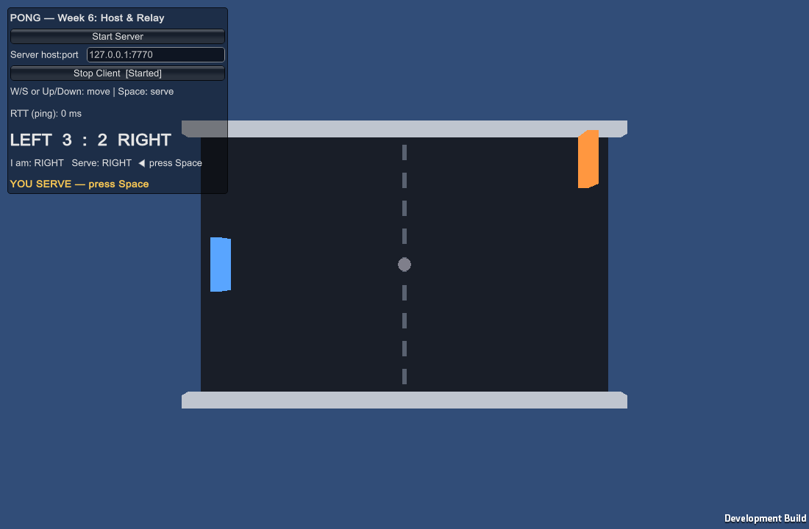

# Verification results

## Interface and language

Project documentation, setup instructions, interface text, errors and authored filenames are in English. Screenshots were recaptured from the English interface. Code comments remain removed. Feed, traffic counters, tick and client ID rows are hidden by default; score, RTT, Relay join code and serve/refusal messages remain visible. Console logs remain available for assignment diagnostics.



## Unity build

Unity **6000.3.2f1** successfully produced a Windows Development build. Scene loading, UnityTransport selection, port 7770 and server-authoritative paddle configuration were checked. Existing FishNet nullable/obsolete-API warnings do not block compilation. Cloud project pong is linked and Relay is enabled.

## Two-process local verification

Two independent Windows game processes communicated through UnityTransport. The smoke driver supplied keyboard events to Unity Input System, exercising Update, ServerRpc, TargetRpc, SyncVar and NetworkTransform paths.

| Check | Result |
| --- | --- |
| Two players and paddles spawned | Passed |
| Host LEFT, guest RIGHT | Passed |
| Guest G cannot change authoritative score | Passed on both processes |
| C sends 20 requests in one tick | 19 rejections during the test interval |
| X is clamped to a normal movement tick | Passed |
| Serve refusal reaches only the requesting guest | Passed on both processes |
| Host G changes both scoreboards to 9 | Passed on both processes |
| Host T position reaches both processes | Passed |
| Guest T does not persist against authoritative state | Passed |
| Host Speed 40 increases movement; restored to 8 | Passed |

Both smoke processes recorded `COMPLETE failures=0`. See `local-test-log.txt`. The actual host-G guest capture is `screenshots/host-g-guest.png`. Neither it nor the local captures prove a second-network test.

An authoritative position update is resent every 10 ticks so idle guest teleport changes are corrected. Client Authoritative is off; Send To Owner is on.

## Automated matches and Relay

Two local bot matches completed with roles reversed; both finished 3-2 with matching scores on both processes. See `AUTOMATED_MATCHES.md` and `AutoMatches/results.json`.

A real Relay allocation, join code and guest connection were verified. The Relay match finished 3-2 and guest RTT was 100 ms. See `RELAY_TEST.md`. Both participants ran on one PC.

## Remaining submission work

- A real partner on another network, role reversal, actual connection card and partner screenshot remain pending.
- Notes 6.1/6.2 were not supplied; compare the implementation and indicated line with the lecture notes.
- Local Git commits exist. No GitHub destination was provided, so no push was performed.
- Library, Temp, user settings, built games and access credentials are excluded from the asset package.

## Repeat the smoke test

Build with `-executeMethod Week06Setup.PrepareAndBuild`. Default output: `Builds/Windows/Pong.exe`; override with `-week06-build-output`.

Start both processes with the same future Unix timestamp:

```text
Pong.exe -host -smoke-role host -smoke-start UNIX_SECONDS -logFile host.log
Pong.exe -connect 127.0.0.1:7770 -smoke-role guest -smoke-start UNIX_SECONDS -logFile guest.log
```

Close any previous host so port 7770 is free. Choose a timestamp about 15 seconds ahead. Start the host and wait for its LEFT paddle before starting the guest; simultaneous startup can give LEFT to the guest and invalidate this driver's role assumption. Both processes close after testing. The driver is inactive without `-smoke-role`; Relay is tested separately.
