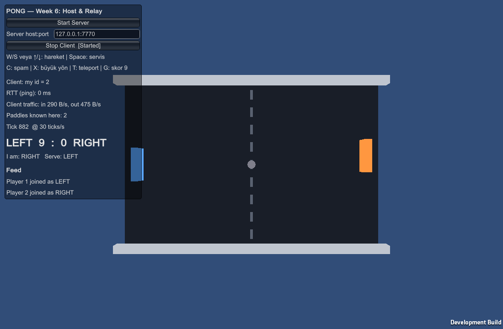

# Week 06 - Homework 3: The Host Cheats and the Join Code

This project continues Week05_Pong_Host. Unity: **6000.3.2f1**. Scene: `Assets/Scenes/Pong.unity`. Original scene and prefab GUIDs are preserved. FishNet remains 4.7.3R. Packages and ProjectSettings were added because the original file was an asset package, not a complete project.

## Requirements and points

Demonstrate that guest cheats cannot change authoritative server state, while direct host writes can. Then connect through a Relay join code without entering an IP address.

| Step | Requirement | Points |
| --- | --- | --- |
| 1 | Guest C/X/T/G cheats fail | 1 |
| 2 | One serve request per player per second; private TOO FAST notification | 2 |
| 3 | Host cheats, Speed 40 and three answers | 2 |
| 4-6 | UnityTransport, RelayLink, two buttons and a join code | 2 |
| 7 | Partner on a different network, play to 3 points, swap roles | 2 |
| Submission | README, two vocabulary terms, indicated line and timely GitHub push | 1 |

The sheet requests a commit and push after each step. A push after 12:00 loses the README point; the supplied sheet does not specify the submission date. Do not commit passwords, keys/tokens or Library.

## Setup

1. Open the project with Unity **6000.3.2f1**, or import the unitypackage into the existing Week05 URP project.
2. Wait for dependency installation and compilation. Internet and Git are required. If necessary, select **Week06 > Install required Relay packages**.
3. Select **Week06 > Prepare and validate project**. This saves the scene, configures URP and selects UnityTransport on port 7770. Tugboat remains present but unused.
4. Open `Assets/Scenes/Pong.unity`. In Multiplayer Play Mode, enable **one additional player** and do not use a Server tag.
5. Enter Play Mode. Main Editor: **Start Host**. Guest: address **127.0.0.1**, then **Start Client**.
6. W/S or Up/Down moves; Space serves. First player: LEFT; second: RIGHT.

Cloud project **pong** is linked and Relay is enabled. An unlinked imported project is configured automatically. If already linked elsewhere, select **Week06 > Link to pong Unity Cloud project**. Your partner must use the same Cloud-linked project.

Feed and technical debug rows are hidden. Score, RTT, join code and serve/refusal notifications remain visible. Show Debug Details on ConnectionHud enables optional diagnostics. Code comments have been removed.

## Code behavior

`Update` reads input only for the owned paddle. `OwnerTick` sends one direction request each network tick. `ServerMove` rejects non-finite values, applies the 30 ms limit, checks the rule, clamps direction to -1/+1, moves using server speed and clamps to court bounds. NetworkTransform has **Client Authoritative off** and **Send To Owner on**. Every 10 ticks, the authoritative position is resent so an idle guest teleport is corrected.

T directly changes local position; G directly attempts a SyncVar score write. They are intentional teaching cheats. `ServerRequestServe` follows null check, rate limit, serving-side/game-state checks, state change and announcement. `TargetRefused` notifies only the requesting connection. `RelayLink` initializes Services, signs in anonymously, creates/joins an allocation, configures transport data and starts networking.

## Step 1 - Guest cheats

Focus the guest and try C/X/T/G individually. Try T with the ball away from the center and watch both windows.

| Key | Expected outcome |
| --- | --- |
| C | 20 requests in one tick: one accepted, 19 Rejected input ... too fast messages |
| X | Direction 100 is clamped to 1; no speed increase |
| T | Guest view jumps briefly; authoritative position restores it |
| G | Host score does not change |

**Why did the host never see the guest G write?** The server owns SyncVar write authority. A direct client write is not an RPC and cannot change the server's authoritative score.

Commit: `Homework 3: guest cheats fail`.

## Step 2 - Serve rate limit

`MinServeGap = 1.0`; `_lastServeTime = -1` is an instance field, not static. Each paddle has a separate timestamp. Server time comes from `TimeManager.TicksToTime(TimeManager.Tick)`. An early request calls `TargetRefused(Owner, "TOO FAST")` and returns. The timestamp updates after the rate check and before the serving-side check, so out-of-turn spam is limited too.

Press Space twice quickly on the guest. Only the guest should see TOO FAST. After one second, a new serve is allowed only if it is that player's turn and the ball is not already in play.

Commit: `Homework 3: serve rate limit`.

## Step 3 - Host cheats

Focus the host and try the same keys. While playing, select the host paddle and change Speed from 8 to 40. Move, observe both windows and restore 8.

| Test | Outcome | Reason |
| --- | --- | --- |
| C | 19 rejections, normal speed | Server rate check also applies to host requests |
| X | Normal speed | Direction is clamped |
| T | Persistent position change in both windows | Host position is server position |
| G | LEFT becomes 9 in both windows | Direct authoritative score write |
| Speed 40 | Five times normal speed in both windows | Server speed value changed |

**1. Why did C/X fail while T/G worked?** C/X are validated requests; T/G are direct state writes in the process that also runs the server.

**2. Which cheats can a guest see?** The host T position change, G score change and Speed 40 movement increase; C/X do not bypass the checks.

**3. Host or dedicated server for ranked play with strangers?** A trusted dedicated server independent of players prevents a player from editing server memory and rules.

This real guest screenshot was captured after the host G input during an automated local test. The guest is RIGHT and LEFT is 9. Complete the personal Editor demonstration too.

Commit: `Homework 3: host cheats work`.

## Step 4 - Packages and transport

Dependencies include Multiplayer Services, Input System, URP, Multiplayer Play Mode and FishyUnityTransport pinned to a Git commit. In another project, use Project Settings > Services to link the same Cloud project, enable Relay in its Dashboard and select UnityTransport/port 7770 on NetworkManager and TransportManager. First verify Start Host and 127.0.0.1. Do not add account credentials.

Commit: `Homework 3: UnityTransport`.

## Step 5 - RelayLink.cs

**CreateAllocationAsync returns:** An `Allocation` containing the Relay endpoint, allocation identifier and connection data. Argument 1 reserves one guest slot in addition to the host.

**GetJoinCodeAsync returns:** A string containing the shareable code for the allocation.

**Why SetRelayServerData before StartConnection?** The transport needs its Relay endpoint and allocation data when it opens the connection.

Notes 6.1/6.2 were not supplied. This implementation uses the FishyUnityTransport API for the requested behavior; it is not claimed to be an exact transcription of those notes. Read and explain the code and compare it with the notes before submitting.

API reference: https://github.com/ooonush/FishyUnityTransport

## Step 6 - Buttons and code

Stop and restart Play Mode after local testing. Click **Host via Relay**; buttons are blocked while busy. The HUD shows JOIN CODE and the Console logs `[Relay] Join code: ...`. In the guest instance/build of the same project, enter the code and select **Join via Relay**. Play a rally. Stop Host clears the code, which expires with its host. Separate processes use separate anonymous authentication profiles. Restart Play Mode before returning to IP buttons.

The real same-PC Relay test, screenshots and measurements are in [RELAY_TEST.md](RELAY_TEST.md).

Commit: `Homework 3: join code`.

## Step 7 - Partner on a different network

Two local bot matches completed with roles swapped; both finished 3-2. A real Relay match also completed on the same computer. Movement and serving used W/S and Space without direct ball/score writes. See [AUTOMATED_MATCHES.md](AUTOMATED_MATCHES.md). These are not tests with a real partner on a different network.

Select **Week06 > Build and play automatically (two players)** to run a local bot match. Normal play is unchanged; bots run only when explicitly requested.

Your partner opens your repository with the same Unity version. Host via Relay and share the code yourself. Your partner joins from another home connection or phone hotspot. **Play to 3 points.** Then open your partner's repository and repeat with roles reversed.

| Connection card | Complete after the actual partner test |
| --- | --- |
| Partner name | PENDING |
| Host and guest | PENDING |
| The two networks | PENDING |
| Guest Relay RTT | PENDING - HUD measurement in ms |
| Guest 127.0.0.1 RTT | PENDING - local HUD measurement in ms |
| First attempt and any required fix | PENDING |
| Score at 3 points | PENDING |
| Second test with roles reversed | PENDING |

Add a guest screenshot with RTT and score visible together.

**1. Who connects to whom through Relay?** Host and guest connect to Relay, which forwards packets; the host still makes game decisions.

**2. Why was no router change required?** Both establish outgoing connections to a reachable Relay service; incoming host port forwarding is unnecessary.

**3. Where did the extra milliseconds come from?** The internet route to Relay and the other player, the return route, processing and queuing add delay compared with loopback.

## Vocabulary and the indicated line

- **Authority:** Final decision and write permission over game state.
- **Relay:** A packet-forwarding service, not the authoritative game referee.

**Line to explain:** `direction = Mathf.Clamp(direction, -1f, 1f);` - even if a client sends 100, the server accepts at most 1. The client cannot select the speed multiplier. Replace this explanation if the instructor indicated another line in class.

## Troubleshooting

| Symptom | Check |
| --- | --- |
| RelayService / AuthenticationService missing | Multiplayer Services installation |
| UnityTransport missing | Git and the Git package |
| Host fails immediately | Cloud link, Relay activation and internet |
| Join fails | Typo, stopped host or different Cloud project |
| Code appears but server stops | UnityTransport selected; Relay data configured first |
| Same-PC identity issue | Separate authentication profiles |
| IP fails after Relay | Stop and restart Play Mode |
| RTT above 150 ms | Record it and try another connection |

## Submission checklist

- [x] Cloud project pong linked and Relay enabled.
- [ ] Personally demonstrate C/X/T/G in the Editor and guest.
- [ ] Verify that only the requester sees serve refusal.
- [ ] Demonstrate Speed 40 and restore 8.
- [ ] Add the host-G guest screenshot to the personal submission.
- [ ] Play with a real partner on another network and swap roles.
- [ ] Complete the actual connection card and RTT/score screenshot.
- [ ] Explain the code and compare with Notes 6.1/6.2.
- [ ] Push on time without Library or secrets.

Recorded checks are in `TEST_RESULTS.md`. Expected outcomes and automated evidence do not replace the actual partner test. Repository: https://github.com/benesas/Week06-Pong-Homework3. Uploading the local history does not establish that each step was pushed before the deadline.

## Connection card and test discussion

I hosted the first match and my partner Deniz joined. Deniz opened my project with the same Unity version. I sent the Host via Relay code and Deniz used Join via Relay. We entered no IP address and configured no router port forwarding. The match finished 3-2.

| Item | Test record |
| --- | --- |
| Partner name | Deniz |
| First-match roles | I hosted; Deniz joined |
| Host network | Home Wi-Fi |
| Guest network | Phone hotspot using mobile data |
| Guest Relay RTT | Approximately 84 ms |
| Guest 127.0.0.1 RTT | Approximately 1 ms |
| First connection attempt | Successful; no additional fix |
| First-match score | LEFT 3 - RIGHT 2 |
| Reversed roles | Deniz hosted; I joined Deniz's project |
| Second-match guest RTT | Approximately 91 ms |
| Second-match score | LEFT 3 - RIGHT 2 |

Relay movement felt later than 127.0.0.1 because packets travelled over the internet to Relay and the other player instead of staying on one computer. Relay forwarded packets; the host enforced movement, serve and score rules.

